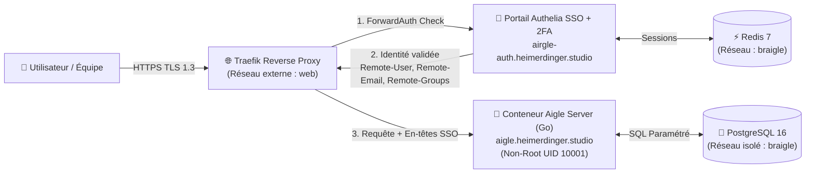

# 🦅 AIGLE SERVER — Édition SaaS Multi-Tenant, Conteneurisée & Protégée par Authelia

Bienvenue dans la documentation officielle du projet **`server/`**, le **serveur SaaS autonome et conteneurisé** de la suite **Aigle**.

Conformément au cahier des charges, ce dossier `/server` constitue **un développement complet et indépendant** de la version locale mono-utilisateur : il dispose de son propre module Go (`github.com/aigle/aigle-server`), de sa propre architecture **Multi-Tenant (Workspaces)**, de sa propre **Console d'Administration Back-Office**, de sa chaîne de sécurité **Zero-Trust Authelia + Traefik**, et de ses manifestes de conteneurisation (**Docker Compose**, **Podman**, **Kubernetes**).

---

## 📑 Table des Matières

1. [Architecture Globale & Flux Zero-Trust (Traefik + Authelia + Aigle)](#1-architecture-globale--flux-zero-trust-traefik--authelia--aigle)
2. [Argumentation des Choix Techniques](#2-argumentation-des-choix-techniques)
3. [Sécurité du Développement & Couverture OWASP Top 10](#3-sécurité-du-développement--couverture-owasp-top-10)
4. [Administration de la Plateforme SaaS (Console Back-Office & RBAC)](#4-administration-de-la-plateforme-saas-console-back-office--rbac)
5. [Structure du Projet `server/`](#5-structure-du-projet-server)
6. [Déploiement Docker Compose avec Traefik & Authelia (`192.168.1.150`)](#6-déploiement-docker-compose-avec-traefik--authelia-1921681150)
7. [Compatibilité Podman & Kubernetes (K8s / K3s)](#7-compatibilité-podman--kubernetes-k8s--k3s)
8. [Compilation & Tests de Sécurité en Local](#8-compilation--tests-de-sécurité-en-local)

---

## 1. Architecture Globale & Double Zone : Portail Public (`/`) vs Espace SaaS Protégé (`/app`)

Pour permettre à vos visiteurs et collaborateurs de découvrir Aigle et de télécharger l'application locale (Windows, macOS, Linux) tout en protégeant strictement l'espace de travail SaaS par **Authelia SSO + 2FA**, l'architecture sur `https://aigle.heimerdinger.studio` est découpée en **deux zones étanches** pilotées à la fois par **Traefik** (`compose.override.yml`), **Authelia** (`configuration.yml`) et le **binaire Go** (`internal/api/server.go` & `public.go`) :

1. **🌐 Zone Publique (Routeur Traefik `aigle-public` — Sans Authelia)** :
   - **`GET /`** : Vitrine publique avec **Mini-Présentation Interactive** (les 4 piliers d'Aigle, les 4 cas concrets d'utilisation, comparatif Local vs SaaS) et **Centre de Téléchargement Multi-OS**.
   - **`GET /public/api/releases`** : Catalogue JSON public des exécutables disponibles avec leur taille et leur empreinte cryptographique **SHA-256** calculée automatiquement par le serveur Go.
   - **`GET /public/downloads/{filename}`** : Téléchargement direct sécurisé (par liste blanche stricte anti-Path-Traversal) des binaires cross-compilés :
     - 🪟 **Windows (x64)** : `aigle-windows-amd64.exe`
     - 🍎 **macOS Apple Silicon (M1/M2/M3/M4)** : `aigle-darwin-arm64`
     - 🍎 **macOS Intel (x86_64)** : `aigle-darwin-amd64`
     - 🐧 **Linux (x86_64 statique)** : `aigle-linux-amd64`
     - 📊 **Supports de présentation** : `aigle-presentation.pptx` et `aigle-presentation.html`
   - **`GET /api/health` & `/assets/*`** : Sonde de santé Docker/K8s et bundle JS/CSS Svelte 5.

2. **🔐 Zone SaaS Protégée (Routeur Traefik `aigle-protected` — Avec Authelia ForwardAuth)** :
   - **`GET /app` (et `/app/*`)** : Dès que l'utilisateur clique sur **"🔐 Connexion Espace Équipe SaaS (Authelia)"**, Traefik intercepte la requête via le middleware `aigle-authelia@docker` (`ForwardAuth` vers `https://airgle-auth.heimerdinger.studio`), exige l'authentification (1FA/2FA), puis ouvre le Workspace SaaS Multi-Tenant et la Console d'Administration.
   - **`/api/*` (hors `/api/health`)** : Toutes les routes API métier (Projets, Gantt, Kanban, Finance, Wiki) et d'administration (`/api/admin/*`) exigent les en-têtes SSO Authelia validés (`withAuth`).



### Cloisonnement Réseau Strict :
- **Réseau externe `web`** : Seuls **Traefik**, **Authelia** (portail de connexion) et **Aigle Server** (derrière le middleware `ForwardAuth`) y sont rattachés. Aucun port (`ports:`) n'est exposé directement sur l'hôte par les conteneurs applicatifs.
- **Réseau bridge interne `braigle`** : La base de données **PostgreSQL 16** (`aigle-postgres`) et le cache de session **Redis 7** (`aigle-authelia-redis`) résident **exclusivement** sur ce réseau privé. Ils sont totalement invisibles depuis Internet et depuis les autres conteneurs clients hébergés sur le serveur `192.168.1.150`.

---

## 2. Argumentation des Choix Techniques

| Composant | Choix Technique | Argumentation & Bénéfices pour le SaaS |
| :--- | :--- | :--- |
| **Backend & API** | **Go (Golang) — Binaire statique (`CGO_ENABLED=0`)** | **Performance, sobriété mémoire (~25 Mo RAM) et sécurité.** Un binaire Go compilé statiquement sans dépendance C (`CGO_ENABLED=0`) s'exécute dans un conteneur minimaliste durci sans interpréteur ni bibliothèque dynamique vulnérable. La concurrence native (goroutines) gère des centaines de flux SSE temps réel sans surcharge CPU. |
| **Authentification & 2FA** | **Authelia (SSO ForwardAuth) + Traefik** | **Délégation cryptographique de l'authentification.** Plutôt que de réinventer la gestion de mots de passe dans l'application, Authelia agit comme bastion SSO en amont : hachage **Argon2id**, double facteur **TOTP / WebAuthn (YubiKey/Passkey)**, protection **anti-bruteforce** (`regulation`), et cookies de session durcis sur `heimerdinger.studio`. |
| **Base de Données** | **PostgreSQL 16 (Prod) + SQLite WAL (Tests/Dev)** | **Concurrence Multi-Tenant & Portabilité.** En production SaaS multi-utilisateurs, PostgreSQL 16 garantit l'intégrité transactionnelle ACID à haute concurrence. Le couche d'abstraction SQL (`internal/database/store.go`) rebinde automatiquement les marqueurs `?` vers `$1, $2...`, ce qui permet d'exécuter les tests de sécurité en mémoire/SQLite sans dépendre d'un démon externe. |
| **Frontend & Console Admin** | **Svelte 5 (Runes) + Tailwind CSS v4 embarqués (`go:embed`)** | **Réactivité chirurgicale sans Virtual DOM.** Svelte 5 compile l'interface (Gantt SVG interactif, Kanban Drag & Drop, Jauge Financière, Wiki et Console d'Administration SaaS) en JavaScript ultra-léger directement embarqué dans le binaire Go. Aucun serveur Node.js n'est requis en production (surface d'attaque réduite). |
| **Conteneurisation** | **Docker Multi-Stage Non-Root (`UID 10001`) + Podman + K8s** | **Standard industriel & isolation.** Le `Dockerfile` compile le frontend (Stage 1 : Bun), compile le binaire statique Go (Stage 2 : Go), et ne copie **que le binaire unique** dans l'image finale (Stage 3 : Alpine 3.21 durcie), exécutée sous l'utilisateur non-privilégié `10001:10001` avec une sonde de santé native (`-healthcheck`). |

---

## 3. Sécurité du Développement & Couverture OWASP Top 10

Le code de `server/` a été développé selon le principe de **Défense en Profondeur (Defense-in-Depth)** : même si une requête franchit le Reverse Proxy, le binaire Go applique ses propres contrôles de sécurité dans [`internal/middleware/security.go`](file:///f:/@PROG/Aigle/server/internal/middleware/security.go) et [`internal/api/server.go`](file:///f:/@PROG/Aigle/server/internal/api/server.go).

### 3.1. A01 — Contrôle d'Accès Défaillant (Broken Access Control & Multi-Tenancy)
- **Validation Zero-Trust sur chaque requête** : Le middleware `withAuth` vérifie systématiquement l'identité transmise par Authelia (`Remote-User`, `Remote-Email`, `Remote-Groups`). En mode `authelia`, toute requête dépourvue de ces en-têtes reçoit immédiatement un `401 Unauthorized` et génère une alerte dans `audit_logs`.
- **Anti-Spoofing d'en-têtes Proxy (`X-Aigle-Proxy-Secret`)** : Si la variable `AIGLE_TRUSTED_PROXY_SECRET` est renseignée, le serveur compare le secret en **temps constant cryptographique** (`subtle.ConstantTimeCompare`) pour prévenir toute attaque temporelle (Timing Attack) ou contournement direct hors Traefik.
- **Isolation Multi-Tenant stricte par `workspace_id`** : Chaque projet, membre, ticket, lot WBS et document est rattaché à un `workspace_id`. Si un utilisateur tente d'accéder à un projet appartenant à un autre Workspace (`handleGetProjectFull`), l'accès est bloqué (`403 Forbidden`) et l'événement `CROSS_TENANT_BLOCKED` est consigné dans le journal d'audit.
- **RBAC à 5 niveaux** :
  - `superadmin` : Accès global à tous les Workspaces + Console d'Administration SaaS (`/api/admin/...`).
  - `admin` : Administration des projets et utilisateurs autorisés.
  - `manager` : Création/modification des projets, budgets initiaux, collaborateurs TJM, planning Gantt et tickets.
  - `member` : Création/déplacement de tickets et sous-tickets, pointage d'heures, édition du Wiki.
  - `viewer` : **Lecture seule stricte** (toute requête `POST`, `PUT`, `PATCH`, `DELETE` est rejetée avec `403 Forbidden`).

### 3.2. A03 — Injections (SQLi & XSS)
- **Zéro concaténation SQL** : 100 % des requêtes dans [`internal/database/store.go`](file:///f:/@PROG/Aigle/server/internal/database/store.go) utilisent des requêtes préparées/paramétrées (`?` convertis automatiquement en `$1, $2...` pour PostgreSQL).
- **Échappement HTML & Politique CSP** : Le moteur Markdown du Wiki échappe systématiquement les balises HTML (`<`, `>`, `&`) avant le formatage, et le middleware HTTP injecte un en-tête `Content-Security-Policy` strict (`frame-ancestors 'none'`, `default-src 'self'`).

### 3.3. A04 & A05 — Conception Insécurisée, DoS & Mauvaise Configuration
- **Limitation de Débit (Rate-Limiting Token Bucket par IP)** : Protège l'API contre les attaques par déni de service applicatif et le balayage intensif (`AIGLE_RATE_LIMIT_RPS=30`, `BURST=80`), renvoyant `429 Too Many Requests` avec `Retry-After`.
- **Limitation de la taille des Payloads (`http.MaxBytesReader`)** : Bloque à **2 Mo** la taille maximale du corps des requêtes entrantes pour empêcher l'épuisement de la mémoire RAM par envoi de JSON géants.
- **Timeouts HTTP Anti-Slowloris** : `ReadHeaderTimeout: 5s`, `ReadTimeout: 15s`, `WriteTimeout: 30s`, `IdleTimeout: 60s`, `MaxHeaderBytes: 1 Mo`.
- **En-têtes HTTP OWASP Systématiques** :
  - `Strict-Transport-Security: max-age=31536000; includeSubDomains; preload`
  - `X-Frame-Options: DENY`
  - `X-Content-Type-Options: nosniff`
  - `Referrer-Policy: strict-origin-when-cross-origin`
  - `Permissions-Policy: camera=(), microphone=(), geolocation=(), payment=()`

### 3.4. Durcissement Conteneur (Docker / Podman / Kubernetes)
- Utilisateur non-root `UID 10001` (`USER 10001:10001`).
- Suppression de toutes les capacités noyau Linux (`cap_drop: [ALL]`).
- Interdiction d'élévation de privilèges (`security_opt: [no-new-privileges:true]`).
- Identifiants d'entités générés via `crypto/rand` (CSPRNG) et jamais par séquences prédictibles faciles à énumérer (anti-IDOR).

---

## 4. Administration de la Plateforme SaaS (Console Back-Office & RBAC)

L'application intègre une **Console d'Administration SaaS complète** accessible aux comptes `superadmin` et `admin` depuis la barre latérale (**"🛡️ Console Admin SaaS"**) ou le 5ème onglet de navigation :

1. **🏢 Gestion des Workspaces Clients (Multi-Tenant)** :
   - Création de nouveaux espaces clients isolés (Nom, Slug, Description).
   - Définition des **quotas par client** (`max_projects`, `max_users`).
   - **Suspension / Réactivation** immédiate d'un Workspace client en un clic.
2. **👥 Gestion des Utilisateurs SSO & Habilitations RBAC** :
   - Synchronisation automatique des utilisateurs lors de leur première connexion via Authelia (`Remote-User`, `Remote-Email`, `Remote-Name`, `Remote-Groups`).
   - Possibilité de **pré-enregistrer** un utilisateur par son email avant même sa première connexion et de lui attribuer son Workspace et son rôle (`superadmin`, `admin`, `manager`, `member`, `viewer`).
   - Bouton d'**arrêt d'urgence (Suspension de compte)** : bloque immédiatement l'accès d'un utilisateur dans Aigle (`403 Forbidden`), même si sa session SSO Authelia est encore active.
3. **📜 Journal d'Audit de Sécurité Immuable (`audit_logs`)** :
   - Enregistre chaque événement critique : `AUTH_REJECTED`, `ACCESS_DENIED_SUSPENDED_USER`, `CROSS_TENANT_BLOCKED`, `ADMIN_WORKSPACE_CREATE`, `ADMIN_USER_UPDATE`, `PROJECT_CREATE`, `PROJECT_DELETE`, `TICKET_DELETE`, etc.
   - Affiche l'horodatage précis, l'email de l'auteur, son rôle RBAC, la cible modifiée et l'**adresse IP réelle** extraite derrière Traefik (`X-Forwarded-For`).

---

## 5. Structure du Projet `server/`

```text
server/
├── cmd/
│   └── aigle-server/
│       └── main.go                 # Point d'entrée HTTP durci, Graceful Shutdown & flag -healthcheck
├── internal/
│   ├── config/
│   │   └── config.go               # Configuration 12-Factor App (Variables d'env & flags CLI)
│   ├── models/
│   │   └── models.go               # Modèles Multi-Tenant (Workspace, User, AuditLog, Project, WBS, Ticket...)
│   ├── middleware/
│   │   └── security.go             # En-têtes OWASP, RateLimiter IP, BodySizeLimit, Authelia ForwardAuth & RBAC
│   ├── engine/
│   │   ├── scheduler.go            # Moteur MS Project CPM (Forward/Backward Pass, Chemin Critique)
│   │   └── financial.go            # Moteur EVM (Budget, Consommé, RAF, Atterrissage + Consolidation Sous-tickets)
│   ├── database/
│   │   ├── store.go                # Persistance SQL paramétrée (PostgreSQL 16 & SQLite WAL)
│   │   └── seed.go                 # Initialisation automatique Multi-Workspaces & SuperAdmin
│   └── api/
│       ├── server.go               # Routeur REST + SSE + API d'Administration (/api/admin/...)
│       └── server_test.go          # Suite de tests de sécurité (Authelia, Anti-Spoofing, RBAC, Multi-Tenant)
├── web/
│   ├── embed.go                    # //go:embed all:dist
│   └── src/
│       ├── App.svelte              # Shell SaaS avec sélecteur de Workspace, profil SSO & 5 onglets
│       └── lib/components/
│           ├── AdminView.svelte    # Console d'Administration SaaS (Tenants, Users RBAC, Audit Logs)
│           ├── GanttView.svelte    # Diagramme de Gantt interactif & WBS MS Project
│           ├── KanbanView.svelte   # Kanban Hybride + Sous-tickets Enfants + Pointage RAF
│           ├── FinanceView.svelte  # Tableau de bord financier EVM & TJM
│           └── WikiView.svelte     # Documentation Markdown liée aux tickets
├── authelia/
│   ├── configuration.yml.example   # Configuration Authelia v4 (Argon2id, 2FA, Redis, Access Control)
│   └── users_database.yml.example  # Base d'utilisateurs et groupes Authelia
├── k8s/
│   └── deployment.yaml             # Manifestes Kubernetes (Namespace, StatefulSet PG, Deployment, Ingress)
├── Dockerfile                      # Build Multi-Stage durci (Bun -> Go Static -> Alpine Non-Root 10001)
├── compose.yml                     # Stack Docker/Podman (aigle-server, aigle-postgres, authelia, redis)
├── compose.override.yml            # Labels Traefik exacts (web, websecure, myresolver, ForwardAuth)
├── .env.example                    # Modèle des variables d'environnement
├── build-server.cmd                # Script Windows de build complet + exécution des tests de sécurité
└── dev-server.cmd                  # Script Windows de lancement local rapide en mode dev
```

---

## 6. Déploiement Docker Compose avec Traefik & Authelia (`192.168.1.150`)

Les fichiers [`compose.yml`](file:///f:/@PROG/Aigle/server/compose.yml) et [`compose.override.yml`](file:///f:/@PROG/Aigle/server/compose.override.yml) ont été configurés sur-mesure pour s'intégrer **sans aucun conflit** au Reverse Proxy Traefik existant sur votre serveur `192.168.1.150` :
- Réseau externe Traefik : `web` (`external: true`)
- Entrypoint HTTPS : `websecure`
- CertResolver Let's Encrypt : `myresolver`
- Sous-domaines configurés :
  - Application Aigle : `https://aigle.heimerdinger.studio`
  - Portail SSO Authelia : `https://airgle-auth.heimerdinger.studio` (supporte également `aigle-auth.heimerdinger.studio`)

### Étapes de mise en production sur le serveur :

```bash
# 1. Se placer dans le dossier server/
cd server

# 2. Préparer le fichier d'environnement .env
cp .env.example .env
# Éditez .env pour définir un mot de passe PostgreSQL robuste (POSTGRES_PASSWORD)

# 3. Préparer la configuration Authelia
cp authelia/configuration.yml.example authelia/configuration.yml
cp authelia/users_database.yml.example authelia/users_database.yml
# Remplacez les 3 secrets dans authelia/configuration.yml par des chaînes aléatoires de 64 caractères

# 4. Générer votre mot de passe Argon2id pour Authelia (si souhaité)
docker run --rm authelia/authelia:latest authelia crypto hash generate argon2 --password 'VotreMotDePasseSecurise'

# 5. Lancer la stack complète en arrière-plan (build de l'image + démarrage PostgreSQL, Redis, Authelia, Aigle)
docker compose up -d --build

# 6. Vérifier l'état de santé des conteneurs
docker compose ps
```

---

## 7. Compatibilité Podman & Kubernetes (K8s / K3s)

### Avec Podman (Mode Rootless)
Le `Dockerfile` utilisant un utilisateur non-privilégié (`10001:10001`) et ne requérant aucun démon privilégié, la stack fonctionne nativement avec **Podman** :
```bash
podman-compose up -d --build
```

### Avec Kubernetes (K8s / K3s / OpenShift)
Un manifeste complet est fourni dans [`k8s/deployment.yaml`](file:///f:/@PROG/Aigle/server/k8s/deployment.yaml) incluant :
- Le `Namespace` isolé `aigle-saas`
- Le `StatefulSet` PostgreSQL 16 avec `PersistentVolumeClaim`
- Le `Deployment` `aigle-server` à 2 réplicas avec `securityContext` (`runAsNonRoot: true`, `readOnlyRootFilesystem: true`, `capabilities.drop: ["ALL"]`) et sondes `livenessProbe` / `readinessProbe` sur `/api/health`
- L'`Ingress` annoté pour Traefik (`websecure` + `myresolver`).

```bash
kubectl apply -f k8s/deployment.yaml
```

---

## 8. Compilation & Tests de Sécurité en Local

Sur Windows, deux scripts prêts à l'emploi sont fournis dans `server/` :

- **[`build-server.cmd`](file:///f:/@PROG/Aigle/server/build-server.cmd)** :
  1. Installe et compile le frontend Svelte 5 (`server/web/dist`).
  2. Vérifie les dépendances Go (`go mod tidy`).
  3. Exécute les **tests unitaires et de sécurité** (`go test ./... -v` : test du rejet `401` sans Authelia, test anti-spoofing `X-Aigle-Proxy-Secret`, test RBAC `403` pour les comptes `viewer`, test d'accès SuperAdmin `/api/admin/overview` et vérification des `audit_logs`).
  4. Compile le binaire autonome `aigle-server.exe`.
- **[`dev-server.cmd`](file:///f:/@PROG/Aigle/server/dev-server.cmd)** :
  Lance `aigle-server.exe` en mode développement local sur `http://localhost:8090` avec SQLite WAL et le compte SuperAdmin pré-connecté afin de tester immédiatement la Console d'Administration SaaS et le sélecteur Multi-Workspaces.

